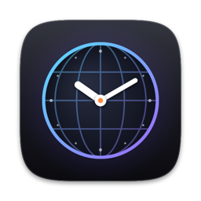
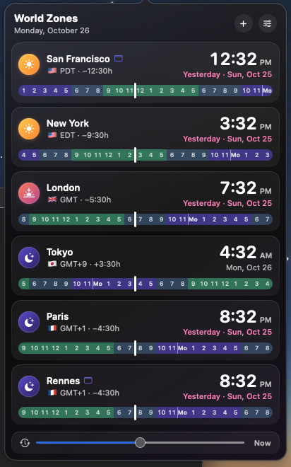
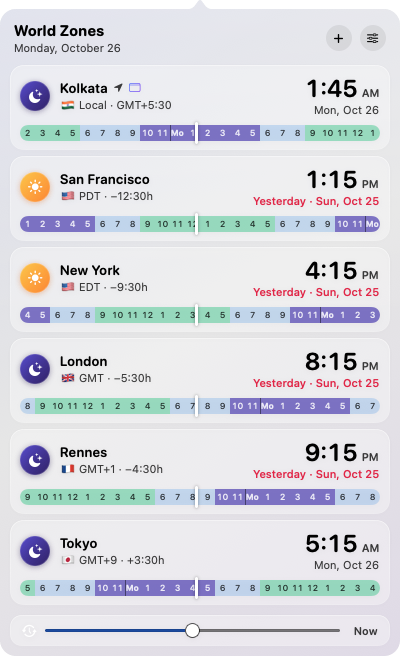
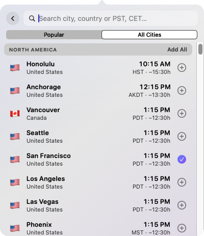
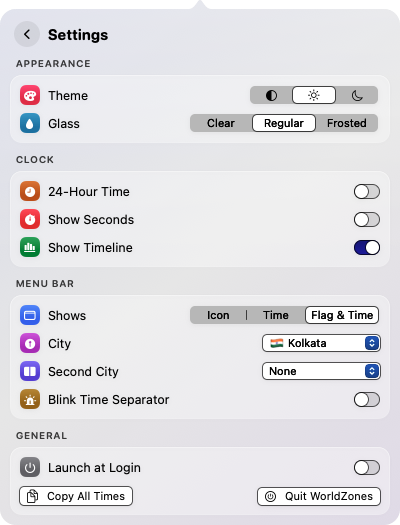

<p align="center">
  
</p>

<h1 align="center">WorldZones</h1>

<p align="center">
  A small, good-looking world clock that lives in your Mac's menu bar.<br>
  See what time it is for your team, friends and family, at a glance.
</p>

<p align="center">
  <a href="https://github.com/anandshbh/worldzones/releases/latest"></a>
  
  
  <a href="LICENSE"></a>
</p>

<p align="center">
  <a href="https://github.com/anandshbh/worldzones/releases/latest/download/WorldZones-1.0.0.dmg"><b>⬇ Download WorldZones 1.0.0 (.dmg, 2.6 MB)</b></a>
</p>

<p align="center">
  
</p>

---

## Features

**In the menu bar**
- Show an icon, the time, or a flag and the time
- Show two cities side by side: `🇫🇷 8:47 PM | 🇺🇸 12:47 PM`
- Optional blinking time separator, seconds, and 24-hour time
- The width never jumps as the time ticks

**In the panel**
- A card for every city with its time, date, UTC offset and difference from you
- "Yesterday" / "Tomorrow" labels when a city is on a different day
- A 24-hour timeline on each card: working hours, evenings and nights at a glance, aligned across cities
- **Time travel:** drag the slider (±24 h, in 15-minute steps) or click any hour on a timeline to see every city at that moment
- **Drag to reorder** cities
- Right-click a card to rename it, copy its time, or pin it to the menu bar
- Copy all times at once, ready to paste into a chat or an invite
- Your local city follows your Mac's time zone automatically

**Adding cities**
- Search by city, country, time zone (`Europe/Paris`) or abbreviation (`PST`, `CET`, `IST`)
- Every city in the IANA time zone database, plus 100+ extra well-known cities (Seattle, Rennes, Bengaluru, Kyoto…)
- **All Cities** browser: about 100 major world cities grouped by region, with one-click **Add All**

**Look and feel**
- System, Light or Dark theme
- Translucent glass panel with Clear, Regular or Frosted strength
- Launch at login

<p align="center">
  
  
  
</p>

## Install

1. Download **WorldZones-1.0.0.dmg** from the [latest release](https://github.com/anandshbh/worldzones/releases/latest).
2. Open it and drag **WorldZones** into **Applications**.
3. Open WorldZones from Applications. It appears only in the menu bar, with no Dock icon.

### "WorldZones can't be opened" on first launch

WorldZones is free and open source, and it isn't signed with a paid Apple Developer ID, so macOS can't verify it the first time. To allow it, do **one** of these:

- Open **System Settings → Privacy & Security**, scroll down, and click **Open Anyway** next to WorldZones.
- Or run this once in Terminal:

  ```bash
  xattr -dr com.apple.quarantine /Applications/WorldZones.app
  ```

You only need to do this once.

## Using WorldZones

| To… | Do this |
|---|---|
| Open or close the panel | Click the menu bar item, or click anywhere else to close it |
| Add a city | Click **+** or press `⌘N`, then type, use `↑` `↓`, and press `Return` |
| Add many cities | **+** → **All Cities**, then click cities or **Add All** for a region |
| Reorder cities | Drag a card up or down |
| Rename, copy or pin a city | Right-click its card |
| See another time | Drag the slider, or click an hour on any timeline. `Esc` returns to now |
| Show two cities in the menu bar | Settings → Menu Bar → **Second City** |
| Open settings | Click the sliders button or press `⌘,` |
| Quit | `⌘Q`, or Settings → **Quit WorldZones** |

## Build from source

You need macOS 14 or later and the Xcode Command Line Tools (the full Xcode app isn't required):

```bash
xcode-select --install
```

Then, from the repository folder:

```bash
./build.sh            # builds build/WorldZones.app (universal: Apple silicon + Intel)
./build.sh install    # also copies it to ~/Applications and quits any running copy
./build.sh dmg        # also packages build/WorldZones-<version>.dmg
```

Build intermediates go in your temporary folder, and `build/` is git-ignored, so nothing built ends up in the repository.

### Making a release

1. Set the version in `Info.plist`: `CFBundleShortVersionString` (for example `1.1.0`) and bump `CFBundleVersion`.
2. Run `./build.sh dmg`, which creates `build/WorldZones-<version>.dmg` with the version in its name.
3. On GitHub, draft a new release tagged `v<version>` and attach that DMG.

### Project layout

| Path | What's in it |
|---|---|
| `Sources/WorldZones/WorldZonesApp.swift` | App entry point (plain AppKit, no Dock icon) |
| `Sources/WorldZones/StatusPanel.swift` | Menu bar item and the panel with its arrow |
| `Sources/WorldZones/AppModel.swift` | Cities, settings, clock and formatting |
| `Sources/WorldZones/ContentView.swift` | City cards, timeline, time slider, drag to reorder |
| `Sources/WorldZones/AddZoneView.swift` | Search, Popular and All Cities |
| `Sources/WorldZones/SettingsView.swift` | Settings page |
| `Sources/WorldZones/ZoneCatalog.swift` | City list, search and flags |
| `Sources/WorldZones/Theme.swift` | Glass styling, panel shape, shared controls |
| `Scripts/make-icon.swift` | Draws the app icon in code |
| `build.sh` | Build, install and DMG packaging |

## Privacy

WorldZones makes no network connections and collects nothing. Your cities and settings stay on your Mac, in the app's preferences.

## Uninstall

Quit WorldZones (`⌘Q`), delete it from Applications, and optionally remove its saved settings:

```bash
defaults delete local.r3vol.worldzones
```

If you turned on **Launch at Login**, turn it off in Settings before deleting the app, or remove it later in System Settings → General → Login Items.

## Contributing

Bug reports and ideas are welcome in [Issues](https://github.com/anandshbh/worldzones/issues). Pull requests are welcome too: please keep changes focused, and check that `./build.sh` still builds.

## License

WorldZones is released under the [MIT License](LICENSE). © 2026 Shubhrant.
